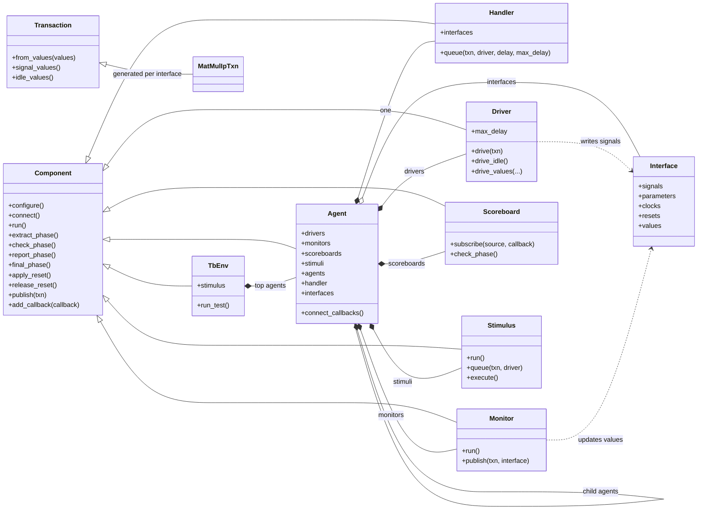
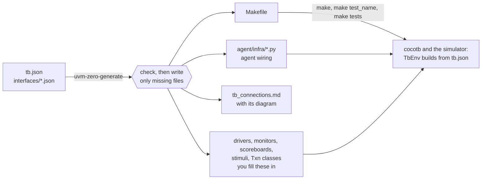
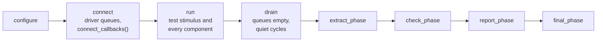

# py-uvm-zero

A small component hierarchy for cocotb testbenches. Agents group interfaces,
drivers, monitors, scoreboards, and registered stimuli. A test picks one
registered stimulus to run; protocol behavior stays in your classes.

The pip distribution is `py-uvm-zero`; Python imports use `uvm_zero_base`.

## Setup

Use Python 3.10+, cocotb 2.1, GNU Make, Icarus Verilog for framework checks,
and Verilator 5.036+ for the AXI example.

```sh
python -m venv .venv
source .venv/bin/activate
python -m pip install -e .
make
```

| Command | Purpose |
| --- | --- |
| `make compile` | Compile Python sources. |
| `make framework-test` | Run the existing framework simulations. |
| `make axi-verify` | Verify pinned vendor files. |
| `make axi-lint` | Elaborate the AXI mux, demux, and crossbar. |
| `make axi-sim` | Run every test of the AXI testbench generated from `tb/tb.json`. |
| `make matrix-sim` | Run every test of the filled-in matrix testbench (`tb_impl/`). |
| `make clean` | Remove simulation build outputs. |

## Layout

```text
src/
  uvm_zero_base/       runtime and common cocotb test
  uvm_zero_builder/    JSON validation, construction, and class generation
  common_uvc/
    clock/            clock driver and optional period monitor
    reset/            reset driver, monitor, and handler
  examples/
    axi/              rtl/ (harnesses, files.f), tb/ (generated from tb.json), pinned vendor/
    matrix_multiplier/  rtl/; tb/ as generated from JSON; tb_impl/ the same, filled in
tests/                framework simulations
```

## Architecture

How a transaction moves through a `uvm_zero_base` testbench:

```mermaid
flowchart LR
  test(["test in simulation.tests"]) -.->|runs| stim["Stimulus<br/>registered with an agent"]
  stim -->|"queue(txn, driver, max_delay)"| handler[("Agent handler<br/>one queue per driver")]
  handler -->|"pop, then wait the delay"| drv["Driver.drive(txn)"]
  drv -->|"drive_values(**txn.signal_values())"| sig[/"Interface signals"/]
  sig <-->|"pins"| dut[["DUT"]]
  sig -->|"sampled on every change"| vals[/"interface.values<br/>read only"/]
  vals -->|"read at the clock edge"| mon["Monitor.run()"]
  mon -->|"publish(Txn.from_values(values))"| sb["Scoreboard<br/>on_source_callback(txn)"]
  sb -->|"publish(txn)"| next["another Scoreboard<br/>or a Stimulus"]
  vals -.->|"current status"| stim
```



The generator draws the same picture for a real testbench, from its `tb.json`, at the
top of the `tb_connections.md` it writes. The matrix multiplier's agent, for example:

- [Matrix multiplier, filled in](src/examples/matrix_multiplier/tb_impl/tb_connections.md#diagram):
  the `mat_mul` agent with its `ip` and `op` interfaces, `ip_driver`, two monitors,
  scoreboard, and `traffic` stimulus, run by test `smoke`.
- [Matrix multiplier, as generated](src/examples/matrix_multiplier/tb/tb_connections.md#diagram):
  the same structure, straight from the generator.
- [AXI crossbar](src/examples/axi/tb/tb_connections.md#diagram): the `xbar` agent
  with `initiator` and `target` child agents.

The classes and what each agent holds:



From a JSON description to a running simulation:



## Lifecycle

Construct the hierarchy in constructors. `TbEnv.run_test()` handles:



`configure` and `final_phase` visit parents first; other synchronous phases visit
children first. Each hook handles its own component. `Agent.connect()` gives
each driver its queue and then calls `connect_callbacks()`, where components are
connected; override `connect_callbacks()` rather than `connect()`.

## Agents, interfaces, and the handler

```python
from uvm_zero_base import Agent, Driver, Handler, Interface, Monitor, Scoreboard, Stimulus, TbEnv, Transaction
from common_uvc import ClockAgent, ResetAgent, ResetHandler

class PortAgent(Agent):
    driver_types = {"driver": PortDriver}
    monitor_types = {"monitor": PortMonitor}
    scoreboard_types = {"check": PortScoreboard, "summary": PortSummaryScoreboard}
    stimulus_types = {"traffic": PortTraffic, "burst": PortBurst}
```

Factories receive `(name, parent)`; everything is optional and lands in
`agent.drivers`, `.monitors`, `.scoreboards`, `.stimuli`, and `.agents`
(`agent_types`, with `agent_options` for their settings). `active=False` takes no
drivers or stimuli.

**Interfaces hold the observed state.** An `Interface` maps DUT signals and
parameters. Its monitors keep `interface.values` current: the base monitor
refreshes it whenever a signal changes, and `publish()` refreshes it before
delivering. It is read only for everyone else.

| | Signals (`ip.valid`) | Observed values (`ip.values.valid`) |
| --- | --- | --- |
| What | The cocotb handle of the DUT signal. | What the monitors last saw on it. |
| Driver | Writes, through `drive_values()`. | May read; never writes. |
| Monitor | Waits on edges; samples. | Updates, through the base class. |
| Stimulus | — | Reads the current status. |

`driver.drive_values("ip", valid=1, a=value)` writes a signal only when it
differs from the live DUT value, and never touches `values`. Parameters are
constants (`ip.rows`), described under [Interface JSON](#json-configuration-and-generated-code).

**One handler per agent.** `agent.handler` holds a queue for each of the agent's
drivers and `handler.interfaces`: every interface of the agent and its child
agents, keyed `"ip"` or `"aw.port"`. A stimulus reaches it as `self.handler`, so
it can queue items and read any interface's status:

```python
class PortTraffic(Stimulus):
    async def run(self):
        while self.handler.interfaces["ip"].values.ready != 1:
            await RisingEdge(self.handler.interfaces["ip"].clk)
        self.queue(Transaction(7), driver="driver")
        await self.agent.stimuli["burst"].execute()   # another registered stimulus
        await self.wait_idle()
```

| Operation | Behavior |
| --- | --- |
| `stimulus.queue(item, driver="port.driver")` | Queue work in the selected driver's queue. |
| `await stimulus.send(item, driver="port.driver")` | Drive now; return success or reset cancellation. |
| `await stimulus.wait_idle()` | Wait for every queue below this stimulus's agent. |
| `await other_stimulus.execute()` | Run another stimulus; `False` if a reset cancelled it. |
| `await driver.send(item)` | Serialize and execute `drive(item)`. |
| `handler.queue(item, driver="driver")` | Queue directly, including from a callback. |
| `component.publish(item)` | Deliver to every connected component; a monitor names the interface. |

Driver paths are relative to the stimulus's agent. An agent's reset cancels any
stimulus started with `execute()`, which then returns `False`. The test's own
stimulus is different: the env runs it, so no agent reset stops it, even one the
test applies itself with `await env.reset.pulse()`. Set
`env.reset_handler.restart_sequence = True` (or `"restart_sequence": true` under
`reset` in the JSON) to restart it from the top after every reset instead.

## Tests and stimuli

An agent registers any number of stimuli. A stimulus runs only when a test names
it, or when another stimulus calls its `execute()`. Tests live under
`simulation` in the config and may only name registered stimuli:

```json
"simulation": {
  "tests": {"smoke": "MatMulTraffic", "burst": "MatMulBurst"}
}
```

`TB_TEST=burst` picks a test; without it, the first one runs. With a `TB_CONFIG`,
`TB_SEQUENCE` is refused, so only registered stimuli can run.
`TB_SEQUENCE_CONFIG` overrides attributes the stimulus sets in `__init__`, such as
`{"count": 20}`. Without a config, a Python `TbEnv(sequence_type=...)` still
creates its own top stimulus.

The base scoreboard provides callback subscriptions, the shared heartbeat and
optional observation history. Matching requests to responses, queues, timeouts,
reset policy and final completion checks belong in the extended scoreboard.
The base does not infer whether a protocol transaction is pending.

### Connections

Nothing is connected automatically, apart from each driver to its queue in the
agent's handler. Every route between components is explicit and lives in the
agent's `connect_callbacks()`. Any component can be a source: monitors call
`publish(item, interface=...)`, and scoreboards, stimuli and drivers call
`publish(item)`. The target receives each item at `on_<source>_callback`:

```python
def connect_callbacks(self):
    board = self.scoreboards["scoreboard"]
    board.subscribe(self.monitors["ip_monitor"], board.on_ip_monitor_callback)
    board.subscribe(self.monitors["op_monitor"], board.on_op_monitor_callback)
    # A scoreboard forwarding results to a stimulus:
    self.scoreboards["check_scoreboard"].add_callback(self.stimuli["traffic"].on_check_scoreboard_callback)
```

`Scoreboard.subscribe()` records the item and emits heartbeat before calling the
checker; `add_callback()` delivers it directly. Routing follows the connection,
never `transaction.source`. Generated agents write these lines from the JSON
`connections`.

## JSON configuration and generated code

The matrix [tb.json](src/examples/matrix_multiplier/tb/tb.json) references
[input.json](src/examples/matrix_multiplier/tb/interfaces/input.json) and
[output.json](src/examples/matrix_multiplier/tb/interfaces/output.json).
`tb/` holds exactly what the generator writes, with every protocol method still
raising `NotImplementedError`. `tb_impl/` is a copy of it with the protocol filled
in: the driver presents each A and B for one clock edge, the monitors publish
accepted requests and results, the scoreboard checks every result against a
reference model sized from the DUT's parameters, and the stimulus sends random
matrices. Compare the two directories to see what a user writes.

```sh
uvm-zero-generate src/examples/matrix_multiplier/tb/tb.json --check
uvm-zero-generate src/examples/matrix_multiplier/tb/tb.json
```

Generation writes ordinary Python next to the configuration:

```text
mat_mul/
  agent/
    infra/                       editable agent constructor and connect_callbacks() wiring
      mat_mul_agent.py
    mat_mul_ip_driver.py         protocol implementation
    mat_mul_ip_monitor.py
    mat_mul_op_monitor.py
    mat_mul_scoreboard.py
    mat_mul_ip_txn.py            one Txn class (a Transaction subclass) per interface
    mat_mul_op_txn.py
  seqs/
    mat_mul_traffic.py           a registered stimulus, run by test smoke
tb_connections.md                agent hierarchy, components and arrow connections
Makefile                         runs the tests in simulation.tests
```

`agent/infra` is rendered from
[agent.py.tmpl](src/uvm_zero_builder/templates/agent.py.tmpl). `TbEnv` imports those
agent classes: it does not synthesize protocol agents from JSON during simulation.
You can inspect and modify their construction and callback connections. Run the
generator before using a new `TB_CONFIG`; a missing infrastructure module produces
an error naming the generator command.

Normal generation preserves **all existing files**, including infrastructure,
documentation and the Makefile. After a topology change, preview with
`--check --refresh-infra`, then use `--refresh-infra` to replace those three. That
option overwrites edits under `agent/infra` and in the Makefile; it never
overwrites protocol classes or stimulus. Add any new interface callbacks to existing protocol classes
as needed. Documentation describes the JSON/template topology; update it yourself
if you change the connections in Python.

Driver, monitor and scoreboard class names follow the agent hierarchy, such as
`DemoPortDriver` for `demo.port`; stimulus names start with the same prefix, such
as `DemoTraffic`. Each expanded agent has its own infrastructure file; array
instances share their protocol class files.

Within each agent object:

| Key | Value |
| --- | --- |
| `driver`, `monitor`, `scoreboard` | One class name, `true` for the base class, `false`/absent, or a list of class names. |
| `stimulus` | Registered stimuli: one class name, `true`, or a list. Each is keyed by its hint: `MatMulTraffic` is `stimuli["traffic"]`. |
| `connections` | `["<SourceClass> -> <TargetClass>", ...]`, the only routes between components. |
| any key holding a string | An interface file. |
| any key holding an object | A child agent; `port[N]` creates an array, with `{i}` the nearest array's index. |

A single driver or monitor is keyed `driver` or `monitor` and uses every
interface in the agent and below. In a list, each class's hint names its
interface: `MatMulInputMonitor` is `input_monitor` and watches only `input`. A
listed scoreboard's hint is just its name: `MatMulCheckScoreboard` is
`check_scoreboard`.

```json
"mat_mul": {
  "input": "interfaces/input.json",
  "output": "interfaces/output.json",
  "driver": "MatMulDriver",
  "monitor": ["MatMulInputMonitor", "MatMulOutputMonitor"],
  "scoreboard": ["MatMulCheckScoreboard", "MatMulSummaryScoreboard"],
  "stimulus": "MatMulTraffic",
  "connections": [
    "MatMulInputMonitor -> MatMulCheckScoreboard",
    "MatMulOutputMonitor -> MatMulCheckScoreboard",
    "MatMulCheckScoreboard -> MatMulSummaryScoreboard",
    "MatMulCheckScoreboard -> MatMulTraffic"
  ]
}
```

Connections name classes from the declaring agent and the agents below it, so
`true` components, which have no class, cannot be connected. The target receives
items at `on_<source>_callback`, named from where the source sits in the
declaring agent: `MatMulInputMonitor` gives `on_input_monitor_callback`, and a
child agent `aw`'s monitor gives `on_aw_monitor_callback`. A source class used by
an array connects every instance to one callback named after the array
(`on_slave_monitor_callback`), which receives the instance indices first. A
target class must have one instance where the connection is declared; for
per-instance wiring, declare the connection inside the array's own object. The
check reports malformed entries, unknown classes, duplicates, ambiguous targets
and clashing callback names. Generation lists every callback an existing class
still lacks.

An interface lists only required DUT signals. `.valid` is relative to
`connected_module`; `dut.core.valid` is rooted at the DUT. Rename a handle with
`.s_valid_i -> valid`. References such as `{"interface": "lower.json",
"connected_module": "dut.core"}` relocate a lower definition. A relative
module `.child` extends its parent. Named `interfaces` bundles can map driver
and monitor roles independently. Missing DUT paths fail during construction.

Tag clock and reset signals so the framework can treat them properly:

```json
{"signals": [".clk_i -> clk [Clock]", ".reset_i -> reset [Reset]", ".valid_i -> valid", ".a_i -> a"]}
```

A tag follows the entry after one space. `interface.clocks` and
`interface.resets` map the tagged names to their signals. Clocks are left out of
`interface.values`, so monitors do not wake on every edge, and generated
skeletons wait on the tagged clock. Neither clocks nor resets become transaction
fields.

### Transaction classes

The generator writes one `Transaction` subclass per interface, named
`<features><Interface>Txn`, with a field for every signal that is not
tagged and is not a parameter. It goes next to the agent's classes, is created
once, and is yours to edit:

```python
@dataclass
class MatMulIpTxn(Transaction):
    valid: object = None
    a: object = None
    b: object = None
```

```python
# Monitor: build one from the observed values.
self.publish_ip(MatMulIpTxn.from_values(self.interfaces["ip"].values))
# Driver: write the fields that are set; unchanged signals are not written.
self.drive_values("ip", **txn.signal_values())
# Stimulus: queue one for the driver.
self.queue(MatMulIpTxn(valid=1, a=a, b=b), driver="ip_driver")
```

Generated code is typed with these classes: `drive(self, txn: MatMulIpTxn)`,
`publish_ip(self, txn: MatMulIpTxn)`, and every callback fed by a monitor or
driver, such as `on_ip_monitor_callback(self, txn: MatMulIpTxn)`. A component
spanning several interfaces, and a callback fed by a scoreboard or stimulus,
take an untyped `txn`.

Signal names `source`, `sequence`, `driver` and `instance_id` would replace
`Transaction`'s routing attributes, so the check rejects them; rename such a
signal with `-> name`.

Module parameters are not signals. List them under `parameters`, with the same
path and rename syntax:

```json
{
  "signals": [".clk_i -> clk", ".valid_i -> valid", ".a_i -> a"],
  "parameters": [".A_ROWS -> rows", ".A_COLUMNS_B_ROWS -> inner"]
}
```

Each parameter is read once from the elaborated DUT and is a plain constant, as in
RTL: `interface.rows` is an `int`, and `interface.parameters` maps every name to
its value. Monitors never sample parameters, handlers never store them, and
`drive_values()` cannot write them. A parameter listed under `signals`, or a
signal under `parameters`, is an error. Verilator exposes only parameters marked
public, for example with `/*verilator public_flat_rd*/`.

## Running a generated testbench

An optional top-level `simulation` section tells the generator how to build the
DUT. It writes a `Makefile` next to the config:

```json
"simulation": {
  "toplevel": "matrix_multiplier",
  "sources": ["../rtl/matrix_multiplier.sv"],
  "simulator": "verilator",
  "parameters": {"A_ROWS": 4},
  "compile_args": []
}
```

| Key | Meaning |
| --- | --- |
| `toplevel` | The DUT's top module (`COCOTB_TOPLEVEL`). |
| `sources` | RTL files, relative to the config. |
| `simulator` | Default `SIM`; `verilator` unless set. |
| `parameters` | DUT parameter values set at elaboration, like `#(...)` on an RTL instance. Each simulator gets its own option (`-G`, `-P`, `-g`, `-defparam`, `-pvalue+`). |
| `compile_args` | Extra simulator compile arguments. |
| `tests` | Test names to registered stimulus classes; the generated Makefile adds a target per test. |

```sh
make                                    # the first test in simulation.tests
make smoke                              # one test; also make TB_TEST=smoke
make tests                              # every test, one simulation and results file each
make SIM=icarus                         # another simulator
make generate                           # check the config and write missing classes
```

The Makefile reads the test names from `simulation.tests` each time it runs, so
adding, renaming or reordering tests in the JSON needs no new Makefile.

The testbench reads the elaborated parameter values back through each
interface's `parameters`. The DUT stays the single source of truth, whether a
value comes from the RTL default or from `simulation.parameters`.

## Simulation configuration

The common test is `uvm_zero_base.test.run_tb`. An example Makefile selects:

| Variable | Value |
| --- | --- |
| `TB_ENV` | `module:Class`; defaults to `uvm_zero_base:TbEnv`. |
| `TB_TEST` | With `TB_CONFIG`: the test to run from `simulation.tests`; default the first. |
| `TB_SEQUENCE` | Without `TB_CONFIG`: the top stimulus as `module:Class`. |
| `TB_CONFIG` | Testbench JSON filename. |
| `TB_ENV_CONFIG` | JSON filename containing environment constructor options. |
| `TB_SEQUENCE_CONFIG` | JSON file of settings for the top stimulus: constructor arguments, or attribute overrides for a test's stimulus. |
| `TB_INTERFACE_CONFIG` | Interface filename for environments accepting `interface_config`. |

Set the DUT sources, top module, `PYTHONPATH`, and `UVM_ZERO_ROOT` (the package
directory), then include `$(UVM_ZERO_ROOT)/makefiles/sim.mk`.
Configuration variables take filenames, not inline JSON:

```sh
cat > /tmp/tb-options.json <<'JSON'
{"timeout": 100, "timeout_unit": "us"}
JSON
make axi-sim TB_ENV_CONFIG=/tmp/tb-options.json
```

Settings resolve from Python defaults, then `TB_CONFIG.settings`, then explicit
environment constructor options. Defaults are `max_errors=1`, a 1 ms watchdog,
`heartbeat_timeout=1000`, and `drain_cycles=10`. Scoreboard defaults are
`history=0` (disabled); set a positive bound, or `null` to retain every item.

Any scoreboard callback activity restarts the shared heartbeat window. Drain
waits for driver queues, then lets monitors finish the configured quiet window.
Your scoreboard's `check_phase()` should report any protocol work still pending at the
end; use the test's stimulus to wait for protocol completion when more time is needed.
`warn()` continues; `error()` records a failure and stops at the error limit.
Final checking and reporting still run after failures.

## Clock, reset, and RTL sources

Clock/reset UVCs live in the environment. Reset polarity is configurable; pulse
width is `period_ns * duration_factor`, independent of clock cycles. An optional
`release_clock` delays deassertion to a falling edge. Passive reset UVCs reset
their owning agent's subtree. Overlapping reset holds must all release before
component run loops and stimulus execution resume.

`env.reset.pulse()` queues a pulse at once and returns an awaitable for its
release, so `cocotb.start_soon(env.reset.pulse())` followed by
`await env.reset.wait_released()` waits for that pulse. Resetting one driver on
its own frees its queue, so `wait_idle()` and the drain do not hang.

The AXI example's `tb/` is generated from `tb/tb.json`: the clock, the reset, and an
`xbar` agent with `initiator` and `target` child agents, one interface per side of
each crossbar port group. Their drivers' generated `drive_idle()` holds every AXI
input at 0, and the `smoke` test checks only that the crossbar elaborates, runs,
and leaves reset. AXI traffic, monitors, and a scoreboard are not implemented; add
them to `tb.json` and regenerate. The matrix example has the RTL,
its generated skeleton testbench (`tb/`), and a complete testbench built from it
(`tb_impl/`, run by `make matrix-sim`). Design RTL and testbench code remain
separate.

Vendor provenance is recorded in [manifest.json](src/examples/axi/vendor/manifest.json):
AXI commit `d436bd4936ba1c49cd87521df54580c5159114d3` and common_cells commit
`db42769334b4589b4b3fc671b34513bdb98be565`, from PULP's `axi` and `common_cells`
repositories. These are minimal pinned snapshots, not Git submodules.
`src/examples/axi/rtl/files.f` builds the subset; the Bender files record provenance.
Original Solderpad Hardware License 0.51 and Apache-2.0 notices are retained in
`vendor/`; preserve them when redistributing.

The matrix multiplier comes from the cocotb v2.0.0 example, Git blob
`e3d62c2784335eb7f226aa227c777b9fa4b98896`, under CC0-1.0/public domain.
