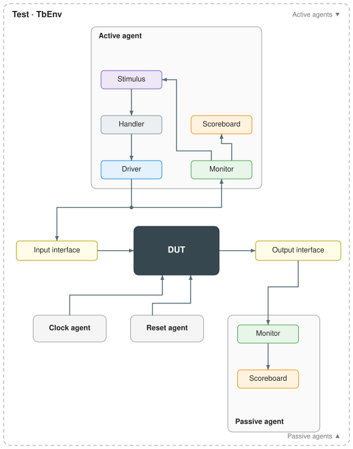

# py-uvm-zero

A small, UVM-shaped component hierarchy for [cocotb](https://www.cocotb.org/)
testbenches, plus a generator that writes the testbench scaffolding from one JSON
file.

The pip distribution is `py-uvm-zero`. Python imports use `uvm_zero_base` (the
runtime), `uvm_zero_builder` (the generator) and `common_uvc` (clock and reset agents).

## Why py-uvm-zero

cocotb gives you coroutines and signal access, and leaves structure to you. Small
benches stay readable, but larger ones tend to grow ad hoc drivers, monitors and
checks that differ from block to block. Full UVM ports for Python bring the
structure, but with SystemVerilog-UVM's weight: factories, configuration databases,
TLM ports and phases that most cocotb users do not need.

py-uvm-zero keeps the parts of UVM that pay off and drops the rest:

- **Familiar shape.** Agents, drivers, monitors, scoreboards, and stimuli (UVM
  sequences) with configure, connect, run and check phases. A UVM engineer can read a
  bench at a glance.
- **Little machinery.** One handler per agent queues work for its drivers. An
  interface holds the values its monitors observe, so a stimulus or scoreboard
  just reads `interface.values`. Connections are explicit callbacks, with no
  ports or exports.
- **Generated scaffolding, hand-written protocol.** A JSON file describes agents,
  interfaces, components, connections and tests. The generator writes the wiring,
  typed transaction classes, protocol skeletons, a Makefile and a diagram, and it
  never overwrites your code.
- **RTL-like parameters.** Module parameters are read from the elaborated DUT, so
  the DUT stays the single source of truth.

## Architecture




| py-uvm-zero | UVM | Role |
| --- | --- | --- |
| `TbEnv` | `uvm_env` and the test | Builds agents, clock and reset; runs the test's stimulus and the phases. |
| `Agent` | `uvm_agent` | Groups interfaces and components; active or passive. |
| `Stimulus` | `uvm_sequence` | Decides what to send; queues transactions for drivers. |
| `Handler` | `uvm_sequencer` | One per agent: a queue per driver, and every interface below. |
| `Driver` | `uvm_driver` | Turns transactions into pin activity. |
| `Monitor` | `uvm_monitor` | Keeps its interface's observed values current; publishes transactions. |
| `Scoreboard` | `uvm_scoreboard` | Checks what monitors publish. |
| `Interface` | virtual interface | DUT signal handles, constants, and the observed values. |
| `Transaction` | `uvm_sequence_item` | A dataclass; one generated subclass per interface. |

Monitors feed both the scoreboards and the stimuli: a stimulus reads the values
the monitors keep current to decide what to send next.

The generator draws this diagram for every testbench, as `tb_diagram.svg` next to
its `tb.json`. Each drawing checks itself for overlapping boxes, wires through
components and connections that don't join up. See the
[matrix multiplier](src/examples/matrix_multiplier/tb_impl/tb_diagram.svg) and
[AXI crossbar](src/examples/axi/tb/tb_diagram.svg) diagrams.

## Setup

Use Python 3.10+, cocotb 2.1, GNU Make, Icarus Verilog for the framework tests,
and Verilator 5.036+ for the examples.

```sh
python -m venv .venv
source .venv/bin/activate
python -m pip install -e .
make            # compile, framework tests, AXI lint and smoke test, matrix testbench
```

| Command | Purpose |
| --- | --- |
| `make compile` | Compile the Python sources. |
| `make framework-test` | Run the framework's own simulations in `tests/`. |
| `make axi-verify` / `axi-lint` / `axi-sim` | Verify the vendored AXI RTL, lint it, run its testbench. |
| `make matrix-sim` | Run the filled-in matrix testbench. |
| `make clean` | Remove simulation outputs. |

## Generating a testbench

1. Describe each interface in its own JSON file: the DUT signals it uses, tagged
   `[Clock]` and `[Reset]` where relevant, and any module parameters.
2. Write a `tb.json`: the DUT sources and tests under `simulation`, the clock and
   reset, and one object per agent naming its interfaces, drivers, monitors,
   scoreboards, stimuli and connections.
3. Preview, then generate. Files are written next to `tb.json`:

   ```sh
   uvm-zero-generate path/to/tb.json --check   # validate and list what would be written
   uvm-zero-generate path/to/tb.json           # write every missing file
   ```

4. Fill in the protocol: the driver's `drive()`, each monitor's sampling, the
   scoreboard's checks, and the stimulus's `run()`.
5. Run it with the generated Makefile: `make`, `make <test>` or `make tests`.

The smallest complete example is the matrix multiplier's
[tb.json](src/examples/matrix_multiplier/tb_impl/tb.json).

## What goes where

```text
src/
  uvm_zero_base/        runtime: Agent, Driver, Monitor, Scoreboard, Stimulus, Handler, Interface, TbEnv
  uvm_zero_builder/     generator: JSON checking, code and Makefile templates, diagram drawing
  common_uvc/           clock and reset agents used by every TbEnv
  examples/
    matrix_multiplier/  one agent, generated (tb/) and filled in (tb_impl/)
    axi/                a parent agent with two child agents around a vendored AXI crossbar
tests/                  the framework's own simulations
docs/                   the architecture diagram above
```

A generated testbench, for an agent called `mat_mul`:

```text
tb.json                          what you write: agents, interfaces, components, connections, tests
interfaces/*.json                what you write: signals and parameters, one file per interface
mat_mul/agent/infra/             generated wiring: agent constructor and connect_callbacks()
mat_mul/agent/mat_mul_*.py       generated once, then yours: drivers, monitors, scoreboards, Txn classes
mat_mul/seqs/mat_mul_*.py        generated once, then yours: stimuli
tb_diagram.svg                   generated: the testbench diagram
Makefile                         generated: runs the tests named in tb.json
```

Files under `infra/`, the diagram and the Makefile follow the JSON: regenerate them
with `--refresh-infra` after a topology change. Everything else is generated only
when missing, so your protocol code is never overwritten.

## Documentation and reading order

1. **This page**: why the project exists, its architecture, and the generation flow.
2. [Matrix multiplier example](src/examples/matrix_multiplier/README.md): the
   smallest real testbench, before and after the protocol is filled in.
3. [Runtime (`uvm_zero_base`)](src/uvm_zero_base/README.md): agents, interfaces, the
   handler, stimuli and tests, connections, phases, settings, clock and reset.
4. [Generator (`uvm_zero_builder`)](src/uvm_zero_builder/README.md): every JSON
   key, naming rules, generated files, transaction classes, parameters, the
   Makefile, and the diagram.
5. [AXI crossbar example](src/examples/axi/README.md): a hierarchy of agents around
   a larger vendored design.

Read the matrix example first if you learn best from code. Read the runtime guide
first if you want the model before the example.
