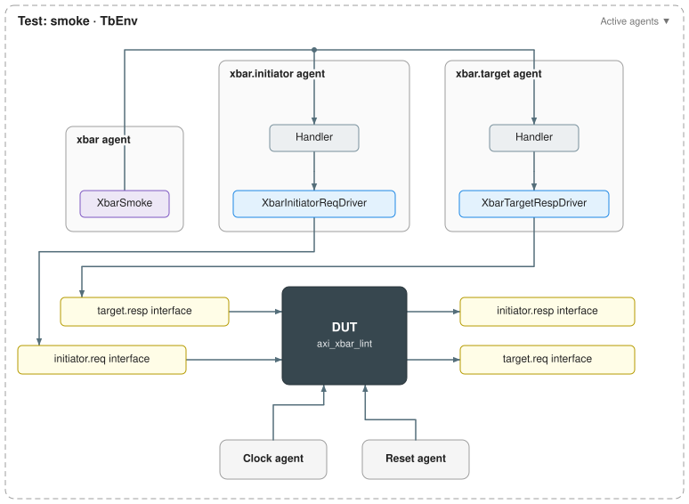

# AXI crossbar example

A py-uvm-zero testbench around PULP's AXI4 crossbar (`axi_xbar`), configured with
four initiators and four targets. It shows a hierarchy of agents: a parent agent
that owns the scenario, with one child agent for each side of the crossbar.

Back to the [project overview](../../../README.md). Read the
[matrix multiplier example](../matrix_multiplier/README.md) first; this one builds
on it.



## What is here

```text
vendor/                  pinned snapshots of PULP's axi and common_cells RTL
verify_vendor.py         checks the vendored files against manifest.json
rtl/
  axi_demo_cfg_pkg.sv    widths, counts and the AXI channel and struct types
  axi_xbar_lint.sv       the simulated DUT: axi_xbar with a four-window address map
  axi_mux_lint.sv        elaboration-only harnesses, linted but not simulated
  axi_demux_lint.sv
  files.f                the vendored files the harnesses need, in compile order
tb/                      the testbench, generated from tb/tb.json and lightly filled in
```

The DUT has four request/response port pairs on each side, as packed arrays of
AXI request and response structs: `slv_req_i`/`slv_resp_o` where initiators
connect, and `mst_req_o`/`mst_resp_i` where targets connect.

## Running it

Verilator 5.036 or newer is required. From the repository root:

```sh
make axi-verify            # check the vendored RTL against its manifest
make axi-lint              # lint the mux, demux and crossbar harnesses
make axi-sim               # every test in tb/tb.json
make -C src/examples/axi/tb smoke
```

## Current status

The testbench is a **smoke test**. The generated drivers' `drive_idle()` holds
every request and response input at 0, and `XbarSmoke` waits for reset to
release and then for a few clock cycles. That proves the crossbar elaborates,
simulates and leaves reset under the framework. It sends no AXI traffic, and
there are no monitors or scoreboard yet.

To grow it into a real testbench:

1. Add monitors to `tb.json`: `XbarInitiatorRespMonitor` on the initiator side and
   `XbarTargetReqMonitor` on the target side, plus a scoreboard in `xbar`.
2. Connect both monitors to the scoreboard in `xbar`'s `connections`, then run
   `uvm-zero-generate tb/tb.json --refresh-infra` to rewire the agents and redraw
   the diagram. Existing protocol files are kept.
3. Fill in the request driver (AW, W and AR channels with their handshakes), the
   target response driver (B and R), the monitors, and the scoreboard's routing
   check against the address map in `axi_xbar_lint.sv`.

## Why the testbench looks like this

**A parent agent, `xbar`, that owns the scenario.** Real crossbar traffic involves
both sides at once: an initiator issues a request, and a target must answer it. The
stimulus therefore sits in the parent. Its handler reaches every interface below
(`initiator.req`, `target.resp`, ...), and it can queue work for the drivers in
either child, such as `driver="initiator.req_driver"` and
`driver="target.resp_driver"`. A scoreboard checking routing would also go here,
since it needs to see both sides.

**One child agent per side, `initiator` and `target`.** The crossbar's two sides
have opposite roles. On the initiator side the testbench plays the AXI managers:
it drives requests and receives responses. On the target side it plays the
subordinates: it receives requests and drives responses. Each child agent groups
one role, which is how a UVM bench would split them into agents.

**Requests and responses as separate interfaces.** Within a side, the testbench
drives one direction and only observes the other. Splitting `req` from `resp`
gives each driver exactly the signals it owns: `XbarInitiatorReqDriver` writes
`slv_req_i` and `XbarTargetRespDriver` writes `mst_resp_i`. The DUT outputs
(`slv_resp_o`, `mst_req_o`) are left for monitors. Each interface also gets its own
transaction class.

**Whole port arrays, not one agent per port.** The harness exposes all four ports
of a side as one packed array, so one interface covers all of them, and a single
idle value fills every element. Per-port agents (`"initiator[4]"` in the JSON) are
possible, but each would then need its own slice of the packed array. That is worth
doing once per-port traffic and checking exist, not for a smoke test.

**Clock and reset from the JSON.** `clk_i` and `rst_ni` are tagged `[Clock]` and
`[Reset]` in every interface file. The reset is active low (`"active_high": false`),
and the generated skeletons wait on the tagged clock.

## Source and licenses

Vendor provenance is recorded in [manifest.json](vendor/manifest.json): AXI commit
`d436bd4936ba1c49cd87521df54580c5159114d3` and common_cells commit
`db42769334b4589b4b3fc671b34513bdb98be565`, from PULP's `axi` and `common_cells`
repositories. These are minimal pinned snapshots, not Git submodules; the Bender
files record their provenance. The original Solderpad Hardware License 0.51 and
Apache-2.0 notices are kept in `vendor/`; preserve them when redistributing.
