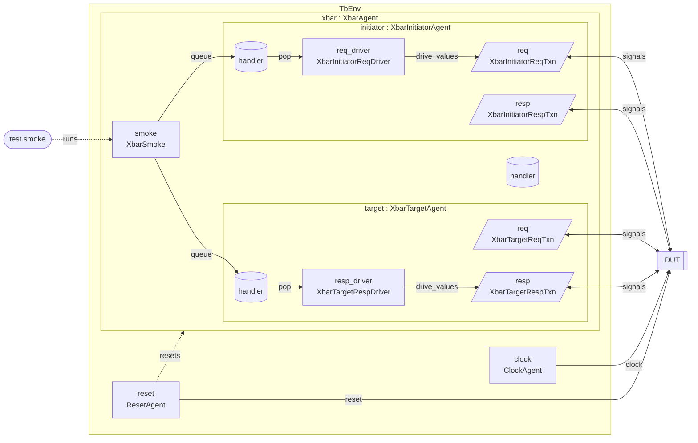

# Testbench connections: tb.json

Generated from the JSON and agent template. If you edit agent/infra wiring manually, update this document too.

## Diagram

Agents are boxes; parallelograms are interfaces, labelled with their Txn class. Arrows follow
the items: stimulus, handler queue, driver, interface, DUT, monitor, then each JSON connection,
labelled with the callback it calls. Dotted arrows show tests and resets.



## Agent hierarchy

- TbEnv
  - clock (ClockAgent)
  - reset (ResetAgent)
  - xbar (XbarAgent)
    - initiator (XbarInitiatorAgent)
    - target (XbarTargetAgent)
    - reset (passive ResetAgent, owned by xbar)

## Tests

- `smoke` runs `XbarSmoke` (default)

## Components and connections by agent

### xbar

- Infrastructure: `xbar/agent/infra/xbar_agent.py`
- Connected module: `dut`
- Handler: `handler`, a queue per driver and every interface below
- Stimulus `smoke`: `XbarSmoke`, run by test smoke
- Child agent: `initiator`
- Child agent: `target`
- Child agent: `reset` (passive ResetAgent)

#### Connections

```text
TbEnv (test smoke) -> stimuli['smoke'].execute()
stimuli['smoke'].queue() -> initiator.handler queue -> initiator.req_driver
stimuli['smoke'].queue() -> target.handler queue -> target.resp_driver
```

### xbar.initiator

- Infrastructure: `xbar/agent/infra/xbar_initiator_agent.py`
- Connected module: `dut`
- Handler: `handler`, a queue per driver and every interface below
- Interface: `req` from `initiator_req.json`; observed values in `req.values`; transaction `XbarInitiatorReqTxn`; `clk` [Clock], `rst_n` [Reset]
- Interface: `resp` from `initiator_resp.json`; observed values in `resp.values`; transaction `XbarInitiatorRespTxn`; `clk` [Clock], `rst_n` [Reset]
- Driver `req_driver`: `XbarInitiatorReqDriver`, using `req`

#### Connections

```text
handler queue -> req_driver.drive() -> req signals -> DUT (writes only changes)
```

### xbar.target

- Infrastructure: `xbar/agent/infra/xbar_target_agent.py`
- Connected module: `dut`
- Handler: `handler`, a queue per driver and every interface below
- Interface: `req` from `target_req.json`; observed values in `req.values`; transaction `XbarTargetReqTxn`; `clk` [Clock], `rst_n` [Reset]
- Interface: `resp` from `target_resp.json`; observed values in `resp.values`; transaction `XbarTargetRespTxn`; `clk` [Clock], `rst_n` [Reset]
- Driver `resp_driver`: `XbarTargetRespDriver`, using `resp`

#### Connections

```text
handler queue -> resp_driver.drive() -> resp signals -> DUT (writes only changes)
```

### clock

- Interface: `clock`
- Monitor: `Monitor`
- Driver: `ClockDriver`

#### Connections

```text
ClockDriver -> clock -> dut.clk_i
dut.clk_i -> monitor -> clock.values
clock -> TbEnv heartbeat_clock
```

### reset

- Handler: `ResetHandler` (extends Handler)
- Interface: `reset`
- Monitor: `ResetMonitor`
- Driver: `ResetDriver`

#### Connections

```text
ResetDriver -> reset -> dut.rst_ni
dut.rst_ni -> ResetMonitor -> reset.values
ResetMonitor -> ResetHandler.observe_reset
ResetHandler.wait_released -> TbEnv test stimulus
```

### xbar.reset

- Handler: `ResetHandler` (extends Handler)
- Interface: `reset`
- Monitor: `ResetMonitor`

#### Connections

```text
dut.rst_ni -> ResetMonitor -> reset.values
ResetMonitor -> ResetHandler.observe_reset
ResetMonitor -> parent.apply_reset / parent.release_reset
```
