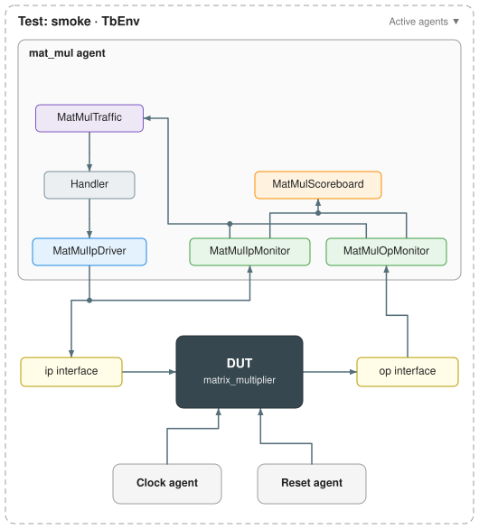

# Matrix multiplier example

The smallest complete py-uvm-zero testbench: one agent around a pipelined matrix
multiplier. It is the best place to see what the generator writes and what a user
adds.

Back to the [project overview](../../../README.md). Background: the
[runtime guide](../../uvm_zero_base/README.md) and the
[generator guide](../../uvm_zero_builder/README.md).



## What is here

```text
rtl/matrix_multiplier.sv    the DUT: C = A x B, with valid in and valid out
tb/                         step 1, what you write: tb.json and interfaces/*.json
tb_generated/               step 2, tb/ plus everything the generator writes
tb_impl/                    step 3, tb_generated/ with the protocol filled in
Makefile                    make sim runs tb_impl/; make generated rebuilds tb_generated/
```

The three folders are the three stages of building a testbench:

1. **`tb/`** holds only the inputs a user writes: `tb.json`, describing the agent,
   its components, connections and tests, and one JSON file per interface.
2. **`tb_generated/`** is `tb/` after `uvm-zero-generate tb.json`: the agent wiring,
   protocol skeletons whose methods raise `NotImplementedError`, the Txn classes, the
   stimulus, the Makefile and `tb_diagram.svg`. It is never edited by hand;
   `make generated` rebuilds it from `tb/`.
3. **`tb_impl/`** is a copy of `tb_generated/` with the protocol filled in. Only the
   driver, monitors, scoreboard and stimulus differ; the wiring, Txn classes,
   Makefile and diagram are identical.

The framework tests check all three stay in step: `tb/` holds only JSON,
`tb_generated/` matches a fresh generation, and `tb_impl/` differs from it only in
protocol files. The protocol filled in for `tb_impl/`:

- **`MatMulIpDriver`** presents A and B with `valid` for one clock, changing them
  on the falling edge, then drops `valid`. At reset, `drive_idle()` writes
  `MatMulIpTxn.idle_values()`.
- **`MatMulIpMonitor`** and **`MatMulOpMonitor`** publish each accepted request and
  each result on the rising edge, built from the interfaces' observed values.
- **`MatMulScoreboard`** computes A x B for every request with a reference model,
  checks each result against the oldest expected one, and in `check_phase()`
  reports requests that never produced a result.
- **`MatMulTraffic`** queues 20 random requests with a random 0-4 cycle gap, sized
  from the DUT's parameters.

Compare the last two folders to see exactly what a user writes:
`diff -r tb_generated/mat_mul tb_impl/mat_mul`.

## Running it

From the repository root:

```sh
make matrix-sim                                       # every test in tb_impl/tb.json
make -C src/examples/matrix_multiplier/tb_impl smoke   # one test
make -C src/examples/matrix_multiplier/tb_impl SIM=icarus
make -C src/examples/matrix_multiplier generated       # rebuild tb_generated/ from tb/
```

To follow the flow yourself, copy `tb/` somewhere, run `uvm-zero-generate tb.json`
in the copy, and compare the result with `tb_generated/`.

Change the run without touching code:

- **Matrix sizes and widths:** add `"parameters": {"A_ROWS": 4}` under
  `simulation` in `tb_impl/tb.json` (and in `tb/tb.json`, to keep the stages
  alike). The traffic and the reference model read the sizes back from the
  elaborated DUT, so nothing else changes.
- **Request count and gaps:** point `TB_SEQUENCE_CONFIG` at a file holding
  `{"count": 100, "max_delay": 0}`.
- **Change the topology:** edit `tb/`, run `make generated`, then copy the new
  wiring into `tb_impl/` with `uvm-zero-generate tb_impl/tb.json --refresh-infra`
  after copying the same JSON there. Your protocol files are kept.

## Why the testbench looks like this

**One agent.** The DUT has a single request path and a single result path, on one
clock and one reset. A result only means something next to the request that caused
it, so both sides belong to one agent, and one scoreboard can see both without
reaching across agents.

**Two interfaces, `ip` and `op`.** The input and output sides carry different
signals in different directions, so each gets its own interface file and its own
transaction class (`MatMulIpTxn`, `MatMulOpTxn`). Each class has exactly the fields
of its side, and generated code is typed with it.

**One driver, listed by interface.** Only the input side is driven; `c_o` and
`valid_o` are DUT outputs. Listing the driver as `["MatMulIpDriver"]` ties it to
`ip` alone, so its `drive_values()` never needs an interface name.

**Two monitors, not one.** A single monitor spanning both interfaces would publish
one mixed item type. Separate monitors publish typed items and give the scoreboard
two clearly named callbacks: `on_ip_monitor_callback` stores the expected result,
and `on_op_monitor_callback` checks the actual one.

**One scoreboard fed by both monitors.** Checking needs the pairing:
`MatMulIpMonitor -> MatMulScoreboard` and `MatMulOpMonitor -> MatMulScoreboard`
are the only two connections. The DUT keeps results in request order, so a queue
of expected results is all the matching needed.

**Parameters, not settings.** `DATA_WIDTH`, `A_ROWS`, `A_COLUMNS_B_ROWS` and
`B_COLUMNS` are listed under `parameters` in the interface files. The testbench
reads them from the elaborated DUT, like an RTL instance would, instead of
duplicating sizes in Python.

## Source

The RTL comes from the cocotb v2.0.0 matrix multiplier example (Git blob
`e3d62c2784335eb7f226aa227c777b9fa4b98896`), under CC0-1.0/public domain.
