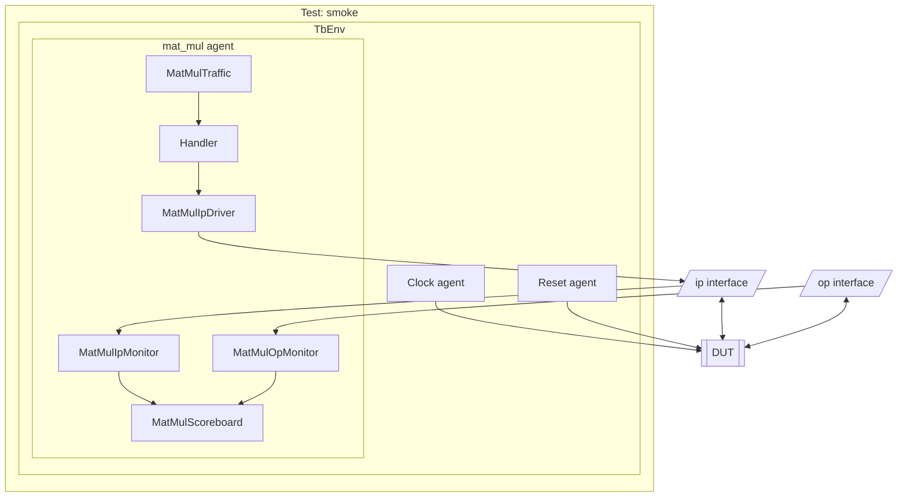

# Testbench connections: tb.json

Generated from the JSON and agent template. If you edit agent/infra wiring manually, update this document too.

## Diagram

The testbench in UVM style: the test, TbEnv, and each agent with its stimuli, handler,
drivers, monitors, and scoreboards. Interfaces connect it to the DUT. The sections below give
every connection in detail.



## Agent hierarchy

- TbEnv
  - clock (ClockAgent)
  - reset (ResetAgent)
  - mat_mul (MatMulAgent)
    - reset (passive ResetAgent, owned by mat_mul)

## Tests

- `smoke` runs `MatMulTraffic` (default)

## Components and connections by agent

### mat_mul

- Infrastructure: `mat_mul/agent/infra/mat_mul_agent.py`
- Connected module: `dut`
- Handler: `handler`, a queue per driver and every interface below
- Interface: `ip` from `input.json`; observed values in `ip.values`; transaction `MatMulIpTxn`; `clk` [Clock], `reset` [Reset]
- Interface: `op` from `output.json`; observed values in `op.values`; transaction `MatMulOpTxn`; `clk` [Clock], `reset` [Reset]
- Monitor `ip_monitor`: `MatMulIpMonitor`, using `ip`
- Monitor `op_monitor`: `MatMulOpMonitor`, using `op`
- Driver `ip_driver`: `MatMulIpDriver`, using `ip`
- Scoreboard `scoreboard`: `MatMulScoreboard`
- Stimulus `traffic`: `MatMulTraffic`, run by test smoke
- Child agent: `reset` (passive ResetAgent)

#### Connections

```text
TbEnv (test smoke) -> stimuli['traffic'].execute()
stimuli['traffic'].queue() -> handler queue -> ip_driver
handler queue -> ip_driver.drive() -> ip signals -> DUT (writes only changes)
DUT -> ip signals -> ip_monitor.publish_ip() -> ip.values
DUT -> op signals -> op_monitor.publish_op() -> op.values
ip_monitor (MatMulIpMonitor) -> scoreboard.on_ip_monitor_callback (scoreboard.callback: history, heartbeat)
op_monitor (MatMulOpMonitor) -> scoreboard.on_op_monitor_callback (scoreboard.callback: history, heartbeat)
```

### clock

- Interface: `clock`
- Monitor: `Monitor`
- Driver: `ClockDriver`

#### Connections

```text
ClockDriver -> clock -> dut.clk_i
dut.clk_i -> monitor -> clock.values
clock -> TbEnv heartbeat_clock
```

### reset

- Handler: `ResetHandler` (extends Handler)
- Interface: `reset`
- Monitor: `ResetMonitor`
- Driver: `ResetDriver`

#### Connections

```text
ResetDriver -> reset -> dut.reset_i
dut.reset_i -> ResetMonitor -> reset.values
ResetMonitor -> ResetHandler.observe_reset
ResetHandler.wait_released -> TbEnv test stimulus
```

### mat_mul.reset

- Handler: `ResetHandler` (extends Handler)
- Interface: `reset`
- Monitor: `ResetMonitor`

#### Connections

```text
dut.reset_i -> ResetMonitor -> reset.values
ResetMonitor -> ResetHandler.observe_reset
ResetMonitor -> parent.apply_reset / parent.release_reset
```
