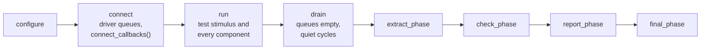

# uvm_zero_base: the runtime

`uvm_zero_base` is the component hierarchy a testbench runs on. It gives cocotb a
UVM-like structure (environment, agents, drivers, monitors, scoreboards and
sequences) without UVM's factories, configuration database or TLM ports. You can
use it directly from Python, or let [the generator](../uvm_zero_builder/README.md)
write the agents from JSON.

Back to the [project overview](../../README.md).

## Files

| File | Holds |
| --- | --- |
| `component.py` | `Component`: the tree, phases, logging, `publish()` and callbacks. |
| `agent.py` | `Agent`: builds its drivers, monitors, scoreboards, stimuli and child agents. |
| `interface.py` | `Interface`: signal handles, parameters, clocks, resets and observed values. |
| `handler.py` | `Handler`: the agent's queue per driver and its view of every interface below. |
| `driver.py` | `Driver`: takes items from its queue, applies delays, and drives with `drive_values()`. |
| `monitor.py` | `Monitor`: keeps its interfaces' observed values current. |
| `scoreboard.py` | `Scoreboard`: subscriptions, shared heartbeat and optional history. |
| `stimulus.py` | `Stimulus`: queues work, sends it, runs other stimuli. |
| `transaction.py` | `Transaction`: the dataclass base for every transaction. |
| `tb_env.py` | `TbEnv`: builds clock, reset and agents; selects and runs the test; watchdog and drain. |
| `settings.py` | Defaults and checks for environment and scoreboard settings. |
| `test.py`, `test_config.py` | The common cocotb test, `run_tb`, and how it reads its `TB_*` variables. |
| `makefiles/sim.mk` | The Makefile fragment a testbench includes. |

The clock and reset agents live next door, in `common_uvc/clock` and `common_uvc/reset`.

## The UVM mapping

| Here | UVM | Notes |
| --- | --- | --- |
| `TbEnv` | `uvm_env` plus `uvm_test` | One environment; the test is the stimulus it runs. |
| `Agent` | `uvm_agent` | `active=False` builds no drivers or stimuli. |
| `Stimulus` | `uvm_sequence` | Registered with an agent; runs only when a test or another stimulus starts it. |
| `Handler` | `uvm_sequencer` | One per agent, with a queue per driver rather than arbitration. |
| `Driver` | `uvm_driver` | Pulls from its queue; `drive()` is the protocol. |
| `Monitor` | `uvm_monitor` | Also the only writer of the interface's observed values. |
| `Scoreboard` | `uvm_scoreboard` | Receives items by callback rather than analysis FIFOs. |
| `Interface` | virtual interface | Also holds what the monitors last saw. |
| callbacks | analysis ports | Explicit, wired in `connect_callbacks()`. |

## Lifecycle

Build the hierarchy in constructors. `TbEnv.run_test()` then runs:



`configure` and `final_phase` visit parents first; the other synchronous phases
visit children first. Each hook handles only its own component. `Agent.connect()`
gives each driver its queue and then calls `connect_callbacks()`, where
components are connected: override `connect_callbacks()`, not `connect()`.

## Agents

```python
from uvm_zero_base import Agent, Driver, Handler, Interface, Monitor, Scoreboard, Stimulus, TbEnv, Transaction
from common_uvc import ClockAgent, ResetAgent, ResetHandler

class PortAgent(Agent):
    driver_types = {"driver": PortDriver}
    monitor_types = {"monitor": PortMonitor}
    scoreboard_types = {"check": PortScoreboard, "summary": PortSummaryScoreboard}
    stimulus_types = {"traffic": PortTraffic, "burst": PortBurst}
```

Each factory receives `(name, parent)`. Every kind is optional, and the results
land in `agent.drivers`, `.monitors`, `.scoreboards`, `.stimuli` and `.agents`
(child agents come from `agent_types`, with `agent_options` for their settings).

## Interfaces hold the observed state

An `Interface` maps DUT signals and parameters. Its monitors keep
`interface.values` current: the base monitor refreshes it whenever a signal
changes, and `publish()` refreshes it before delivering. Everyone else may only
read it.

| | Signals (`ip.valid`) | Observed values (`ip.values.valid`) |
| --- | --- | --- |
| What | The cocotb handle of the DUT signal. | What the monitors last saw on it. |
| Driver | Writes, through `drive_values()`. | May read; never writes. |
| Monitor | Waits on edges; samples. | Updates, through the base class. |
| Stimulus, scoreboard | — | Reads the current status. |

`driver.drive_values(valid=1, a=value)` writes a signal only when it differs from
the live DUT value, and never touches `values`. When a driver has more than one
interface, name it first: `drive_values("ip", valid=1)`. A single value written to
an array signal fills every element.

Signals tagged `[Clock]` are left out of `values`, so monitors don't wake on every
edge; `interface.clocks` and `interface.resets` map the tagged names to their
signals. Parameters are constants read once from the elaborated DUT:
`interface.A_ROWS` is an `int`, and `interface.parameters` maps every name to its
value. Monitors never sample them and `drive_values()` cannot write them.

## One handler per agent

`agent.handler` holds a queue for each of the agent's drivers, and
`handler.interfaces`: every interface of the agent and its child agents, keyed
`"ip"` or `"aw.port"`. A stimulus reaches it as `self.handler`, so it can queue
work and read any interface's status:

```python
class PortTraffic(Stimulus):
    async def run(self):
        ip = self.handler.interfaces["ip"]
        while ip.values.ready != 1:
            await RisingEdge(ip.clk)
        self.queue(PortTxn(valid=1, data=7), driver="driver", max_delay=4)
        await self.agent.stimuli["burst"].execute()   # another registered stimulus
        await self.wait_idle()
```

| Operation | Behavior |
| --- | --- |
| `stimulus.queue(item, driver="port.driver")` | Queue work for the named driver. |
| `stimulus.queue(item, driver=..., delay=N)` | Wait exactly N clock cycles before driving it. |
| `stimulus.queue(item, driver=..., max_delay=N)` | Wait a random 0..N clock cycles first. |
| `await stimulus.send(item, driver="port.driver")` | Drive now; returns success, or `False` if a reset cancelled it. |
| `await stimulus.wait_idle()` | Wait for every queue below this stimulus's agent. |
| `await other_stimulus.execute()` | Run another stimulus; `False` if a reset cancelled it. |
| `handler.queue(item, driver="driver")` | Queue directly, for example from a callback. |
| `component.publish(item)` | Deliver to every connected component; a monitor names the interface. |

Driver names are always explicit and relative to the stimulus's agent. Delays
count cycles of the driver interface's tagged clock; a driver's own `max_delay`
applies when an item sets none.

## Tests and stimuli

An agent registers any number of stimuli. A stimulus runs only when a test names
it, or when another stimulus calls its `execute()`. Tests map names to registered
stimuli, under `simulation.tests` in the testbench JSON:

```json
"simulation": {"tests": {"smoke": "MatMulTraffic", "burst": "MatMulBurst"}}
```

`TB_TEST=burst` picks a test; without it, the first one runs. With a JSON config,
`TB_SEQUENCE` is refused, so only registered stimuli can run.
`TB_SEQUENCE_CONFIG` overrides attributes a stimulus sets in `__init__`, such as
`{"count": 20}`. Without a config, `TbEnv(sequence_type=...)` creates its own top
stimulus.

An agent's reset cancels any stimulus started with `execute()`, which then
returns `False`. The test's own stimulus is different: the environment runs it, so
no agent reset stops it, even one the test applies with `await env.reset.pulse()`.
Set `env.reset_handler.restart_sequence = True` (or `"restart_sequence": true`
under `reset` in the JSON) to restart it from the top after every reset instead.

## Connections

Nothing is connected automatically, apart from each driver to its queue. Every
route between components is explicit and lives in the agent's
`connect_callbacks()`. Any component can be a source: monitors call
`publish(item, interface=...)`, while scoreboards, stimuli and drivers call
`publish(item)`. The target receives each item at `on_<source>_callback`:

```python
def connect_callbacks(self):
    board = self.scoreboards["scoreboard"]
    board.subscribe(self.monitors["ip_monitor"], board.on_ip_monitor_callback)
    board.subscribe(self.monitors["op_monitor"], board.on_op_monitor_callback)
    # A scoreboard forwarding results to a stimulus:
    self.scoreboards["check_scoreboard"].add_callback(self.stimuli["traffic"].on_check_scoreboard_callback)
```

`Scoreboard.subscribe()` records the item and refreshes the heartbeat before
calling the checker; `add_callback()` delivers directly. Routing follows the
connection, never `transaction.source`.

## Scoreboards

The base scoreboard provides subscriptions, the shared heartbeat and optional
observation history (`history=0` disables it, a positive number bounds it, `null`
keeps everything). Matching requests to responses, queues, timeouts, reset policy
and end-of-test checks belong in your subclass, usually in `check_phase()`.
`warn()` continues; `error()` records a failure and stops the test at the error
limit. `extract_phase`, `check_phase`, `report_phase` and `final_phase` still run
after failures.

## Running and settings

The common cocotb test is `uvm_zero_base.test.run_tb`. A Makefile sets the DUT
sources, the top module, `PYTHONPATH` and `UVM_ZERO_ROOT` (this package's
directory), then includes `$(UVM_ZERO_ROOT)/makefiles/sim.mk`. Generated
testbenches get such a Makefile automatically.

| Variable | Value |
| --- | --- |
| `TB_CONFIG` | The testbench JSON. |
| `TB_TEST` | With `TB_CONFIG`: the test to run from `simulation.tests`; default the first. |
| `TB_ENV` | `module:Class`; defaults to `uvm_zero_base:TbEnv`. |
| `TB_SEQUENCE` | Without `TB_CONFIG`: the top stimulus as `module:Class`. |
| `TB_ENV_CONFIG` | A JSON file of environment constructor options. |
| `TB_SEQUENCE_CONFIG` | A JSON file of settings for the top stimulus. |
| `TB_INTERFACE_CONFIG` | An interface file, for environments taking `interface_config`. |

Configuration variables take file names, not inline JSON. Settings resolve from
the Python defaults, then `settings` in the testbench JSON, then explicit
constructor options. The defaults are `max_errors=1`, a 1 ms watchdog,
`heartbeat_timeout=1000` cycles and `drain_cycles=10`. Any scoreboard activity
restarts the heartbeat window. The drain waits for driver queues to empty, then
for the quiet window. Info logging follows `COCOTB_LOG_LEVEL`.

## Clock and reset

`TbEnv` owns a clock agent and a reset agent from `common_uvc`. The clock can be
driven, or passive with an optional period check. Reset polarity is configurable;
the pulse lasts `period_ns * duration_factor`, independent of the clock, and an
optional `release_clock` releases it on a falling edge. Each top-level agent also
gets a passive reset agent that resets its subtree. Overlapping resets must all
release before run loops and stimuli resume.

`env.reset.pulse()` queues a pulse at once and returns an awaitable for its
release, so `cocotb.start_soon(env.reset.pulse())` followed by
`await env.reset.wait_released()` waits for that pulse. Resetting one driver frees
its queue, so `wait_idle()` and the drain do not hang.
